# MiniOS: UI/UX Design

This document describes the interface of the Mini Operating System Simulator: what it looks like, why it is laid out that way, and where each part lives in the code. Everything is plain Java Swing (JDK 17+), with **no external libraries**. Every visual is drawn with Java2D, so the runnable JAR stays dependency-free.

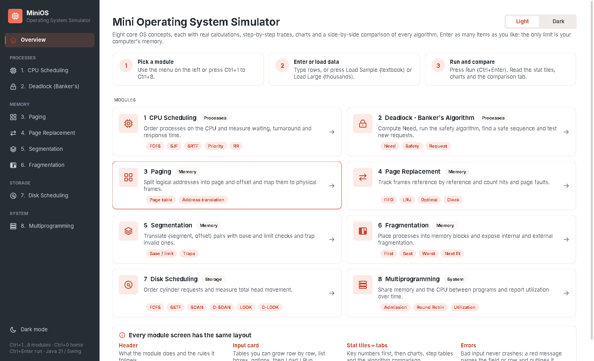

---

## 1. Design goals (from rubric section B)

| Rubric criterion | How the design answers it |
|---|---|
| **Interface design** (clear, organised, consistent) | One page template for all 8 modules: header → input card → stat tiles → result tabs → explanation. Same spacing, colours and type everywhere. |
| **Navigation and controls** | A responsive sidebar (full or icon rail) grouped by OS area (Processes / Memory / Storage / System), a home overview with one card per module, and keyboard shortcuts (`Ctrl+1…8`, `Ctrl+0`, `Ctrl+Enter`, `Ctrl+D`). |
| **Output presentation** | Key numbers first (stat tiles), then a dedicated visual per module (Gantt, frame diagram, memory map…), then sortable tables, a comparison bar chart and a plain-language "How it was calculated" panel. |
| **Error handling** | No modal pop-ups. An inline red banner names the problem, and the faulty **field is outlined in red** or the faulty **table row is highlighted** and scrolled into view. Typing clears the highlight. |
| **Dynamic input flexibility** | Every input table shows a live **row count**; every list box shows a live **value count**. Each module has *Load Large*, and the input card states "Unlimited rows". |

---

## 2. Screen anatomy

```
┌────────────┬───────────────────────────────────────────────────────────────┐
│  MiniOS    │  [icon]  Module title  [category]                             │
│            │          One-paragraph description of the concept             │
│  Overview  │  ┌──────────── inline banner (success / info / error) ─────┐  │
│ PROCESSES  │  └─────────────────────────────────────────────────────────┘  │
│  1 CPU     │  ┌─ Input ───────────────┐ ┌ tile ┐┌ tile ┐┌ tile ┐┌ tile ┐  │
│  2 Deadlock│  │ table / list  [N rows]│ └──────┘└──────┘└──────┘└──────┘  │
│ MEMORY     │  │ + Add  − Remove  Clear│ ┌─ Chart │ Table │ Compare ─────┐  │
│  3 Paging  │  │───── OPTIONS ─────────│ │                              │  │
│  4 Page Rep│  │ Algorithm  Quantum    │ │   module visual / tables     │  │
│  5 Segment │  │───────────────────────│ └──────────────────────────────┘  │
│  6 Fragment│  │ Sample  Large    ▶ Run│ ┌─ How it was calculated ──────┐  │
│ STORAGE …  │  └───────────────────────┘ └──────────────────────────────┘  │
│ ☾ Dark mode│                                                               │
└────────────┴───────────────────────────────────────────────────────────────┘
```

* **Left to right = input to output.** The eye follows the same path as the algorithm.
* **Action bar stays at the bottom of the input card.** *Run* is the only primary (filled blue) button on the screen, so the next step is always obvious.
* **Both split panes can be resized** (input/results and chart/explanation).

---

## 2a. Responsive layout

The window can be resized from full HD down to **720 × 540**, and the layout adapts at each size instead of clipping or squeezing. `MainFrame.adaptLayout()` re-evaluates the layout on every resize and tells the overview and each module screen how much room it has.

| Window | Sidebar | Module screen | Overview |
|---|---|---|---|
| **Wide** (≥ 1180 px) | full sidebar with labels | inputs and results **side by side** (resizable split), 4 stat tiles in a row | 2 columns of module cards, steps in a row |
| **Medium** (< 1180 px) | **icon rail** (68 px); labels move into tooltips | still side by side; stat tiles reflow to **2 × 2** when the results pane is narrow | 1 column of module cards when the content is < 1000 px |
| **Narrow** (content < 960 px) | icon rail | a segmented **Input \| Results** switch shows one pane at a time; **Run jumps to Results** and a validation error jumps back to Input | quick-start steps and guide stack vertically |
| **Short** (height < 680 px) | menu scrolls; shortcut footnote hidden | module description hidden, tighter page margins | – |

Other details:

* **Clicking the logo** collapses or expands the sidebar by hand. The automatic choice comes back the next time the window crosses the 1180 px breakpoint.
* **Option rows and button bars wrap** (`WrapLayout`) instead of being cut off, e.g. *Load Sample / Load Large* move onto two lines in a slim input card.
* **Charts fill the available width** and only scroll when the data really needs more room (thousands of slices, references or requests).
* `GuiSmokeTest` checks every module at a narrow size: the screen must switch to the stacked layout, Run must show Results, and widening the window must restore the split.

| Medium: icon rail, 2 × 2 tiles | Narrow: Results tab | Narrow: Input tab |
|---|---|---|
| 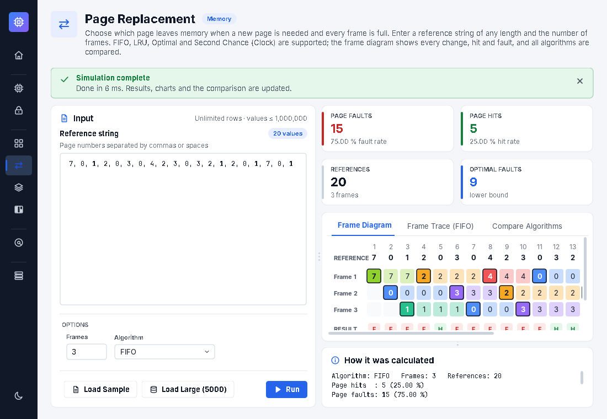 | 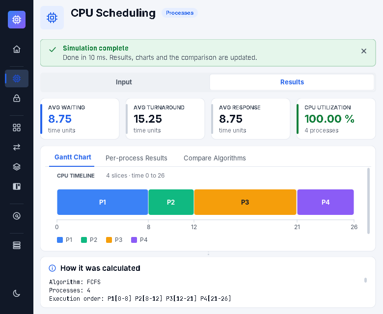 | 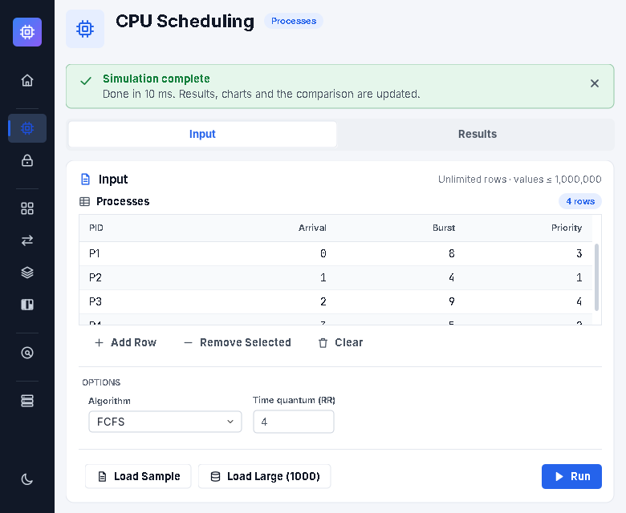 |

---

## 3. Design tokens (`Theme.java`)

Components never hard-code colours. They ask for a *role*, which resolves differently in light and dark mode, so the theme toggle repaints everything.

| Role | Light | Dark | Used for |
|---|---|---|---|
| `BG` | `#F4F6FA` | `#0D1117` | page background |
| `SURFACE` | `#FFFFFF` | `#161B22` | cards, tables, charts |
| `SIDEBAR` | `#111827` | `#090C10` | navigation (dark in both themes) |
| `TEXT` / `TEXT_MUTED` / `TEXT_FAINT` | `#111827` / `#4B5563` / `#6B7280` | `#E6EAF0` / `#A3ADBB` / `#848E9D` | body / secondary / hint text |
| `ACCENT` | `#2563EB` | `#4C8DFF` | primary button, selection, active tab |
| `SUCCESS` | `#15803D` | `#3FB868` | SAFE, HIT, OK, best algorithm |
| `WARNING` | `#B45309` | `#E3A23B` | internal fragmentation, waiting |
| `DANGER` | `#C62828` | `#F2645A` | UNSAFE, FAULT, ERROR, return jump |

* **Series palette:** 10 colours that stay distinct in both themes. `P1`, `J1`, page `0`… always get the same colour, so a process has one colour in the Gantt chart, the legend and the safe-sequence chips.
* **Type scale:** H1 22 bold · H2 15 bold · body 13 · small 12 · stat value 22 bold · monospace 12 for numbers and formulas. The font is the first one installed from *Segoe UI → Inter → SF Pro → Helvetica Neue → Roboto*, so the app looks native on Windows, macOS and Linux.
* **Shape and space:** 10 px radius, 12 px gap grid, 30 px table rows.

---

## 4. Component library

| Component | File | Notes |
|---|---|---|
| Buttons (primary / secondary / ghost) | `Ui.Btn` | painted hover, pressed and focus ring; vector icons |
| Text field, list box | `Ui.Field`, `Ui.textBox` | rounded outline; accent on focus, red on validation error |
| Card | `Ui.Card` | rounded surface with header row |
| Badge / pill | `Ui.Badge`, `Ui.pill` | category labels, counts, verdicts |
| Input table | `InputTable` | live row count, Add/Remove/Clear, Insert key adds a row, error row highlight |
| Matrix editor | `MatrixTable` | Banker's Allocation / Max / Available |
| Result table | `Tables.Styled` | zebra rows, right-aligned monospace numbers, verdict columns drawn as coloured pills, sortable headers, empty state |
| Stat tile | `OutputPane.StatTile` | caption, big value in tone colour, hint |
| Banner | `ModulePanel.Banner` | non-blocking success / info (auto-hide) / error (stays) |
| Flat Swing delegates | `FlatUI` | underline tabs, thin scroll bars, flat combo box, hairline split divider, rounded check box |
| Icons | `Icons` | 25 line icons drawn on a 24×24 grid with Java2D |
| Chart base | `Chart` | hover tooltips, "nice" axis ticks, stretches to the viewport |

---

## 5. Module visuals

Each module gets a visual that matches how the concept is drawn in the textbook. Hover over any chart element to see its exact numbers.

| Module | Visual | What it shows |
|---|---|---|
| CPU Scheduling | `GanttChart` + `BarChart` | slices to scale, idle time hatched, exact boundaries on the axis; average waiting time of every algorithm with the best one tagged |
| Banker's | `SequenceStrip` | SAFE / UNSAFE banner, safe sequence as chips with arrows, blocked processes in red |
| Paging | `PageMap` | page → frame curves, free frames, unmapped pages (page faults) |
| Page Replacement | `FrameGrid` + `BarChart` | the classic frame table: loaded page outlined, H / F row, evicted page; faults per algorithm |
| Segmentation | `SegmentMap` | physical memory with each segment at base…base+limit, overlaps on a second lane, valid translations as markers |
| Fragmentation | `MemoryMap` | one bar per block: allocations coloured, internal fragmentation hatched orange, free holes empty |
| Disk Scheduling | `HeadPathChart` + `BarChart` | head path over cylinders; serves solid, edge travel muted, return jumps dashed red; total movement per algorithm |
| Multiprogramming | `MemoryTimeline` | CPU lane (who runs), memory-in-use step chart against 0–100 %, waiting-for-memory lane |

Large inputs stay usable. Charts scroll sideways or downward, labels are dropped automatically when they would overlap, and the frame and memory diagrams draw the first 300 to 400 items with a note. The tables always hold every row.

| | |
|---|---|
| 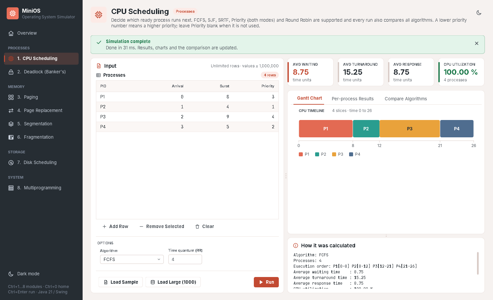 | 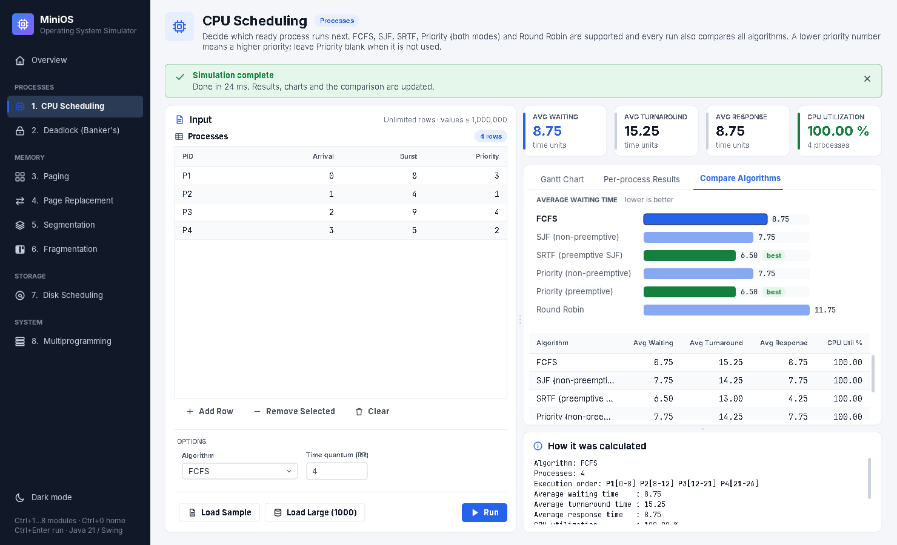 |
| 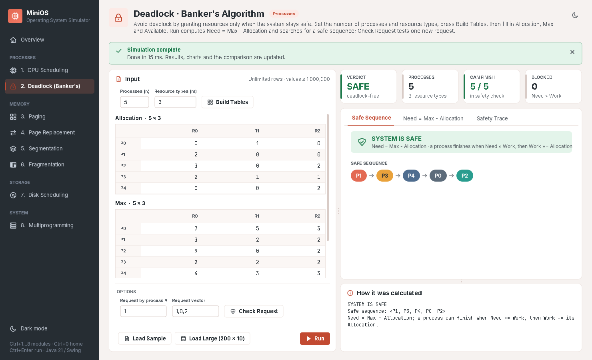 | 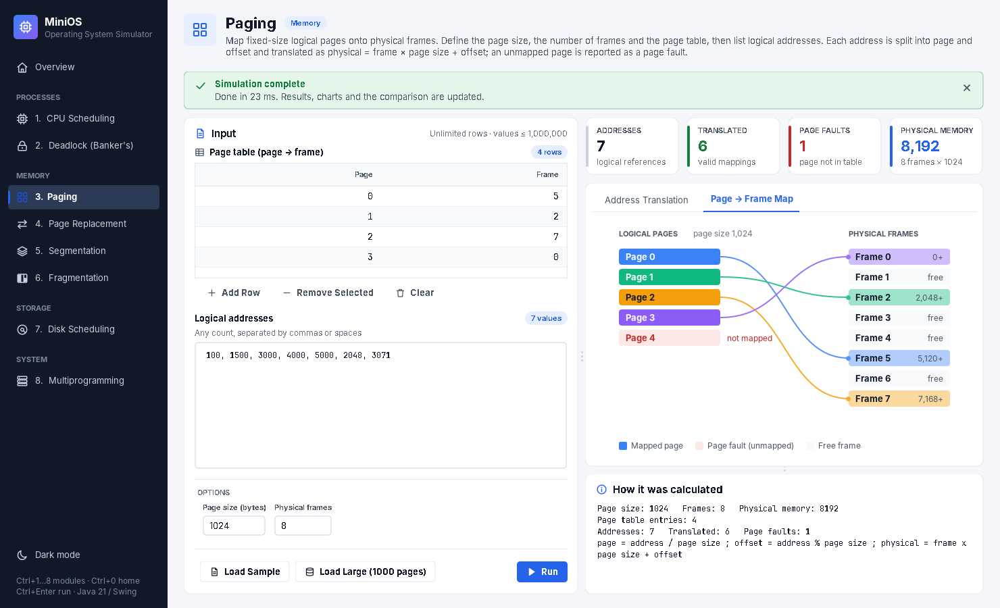 |
| 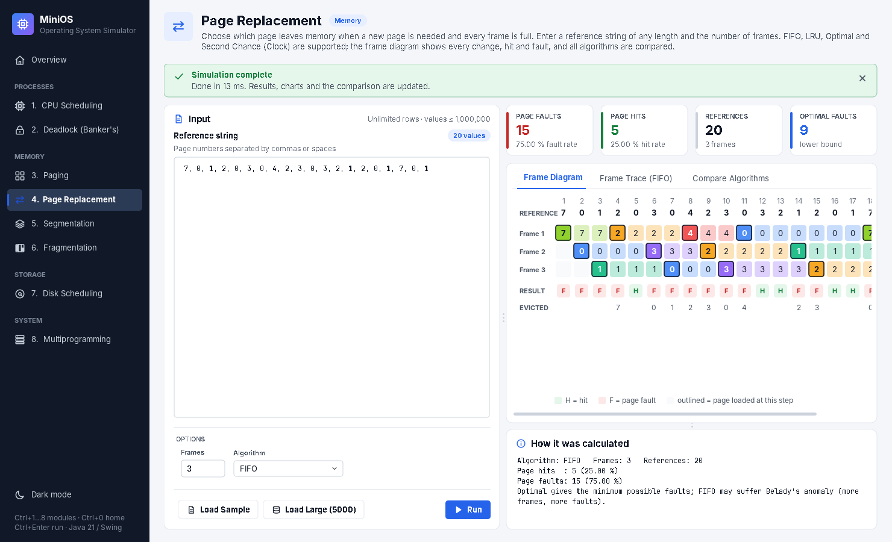 | 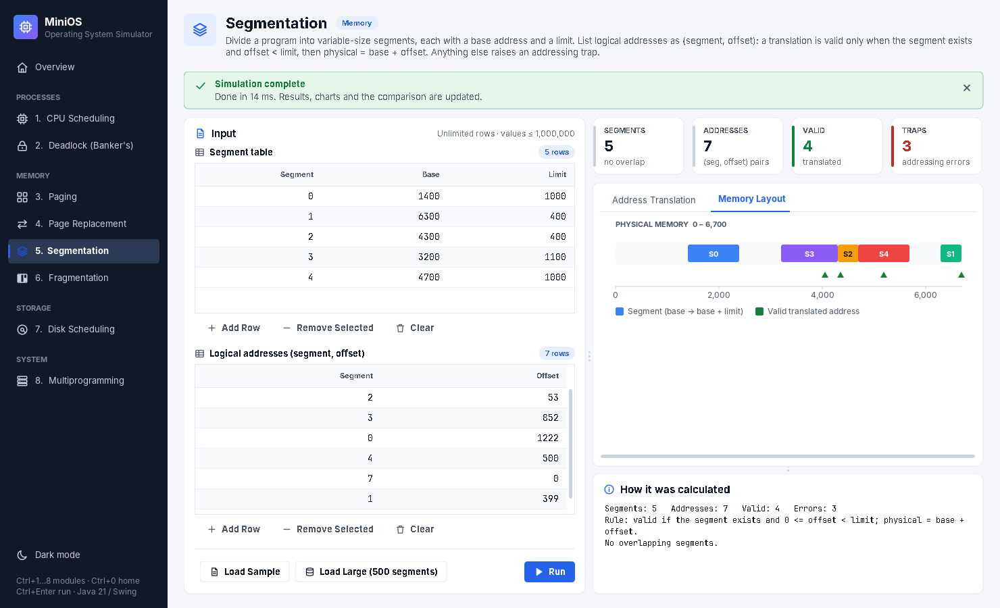 |
| 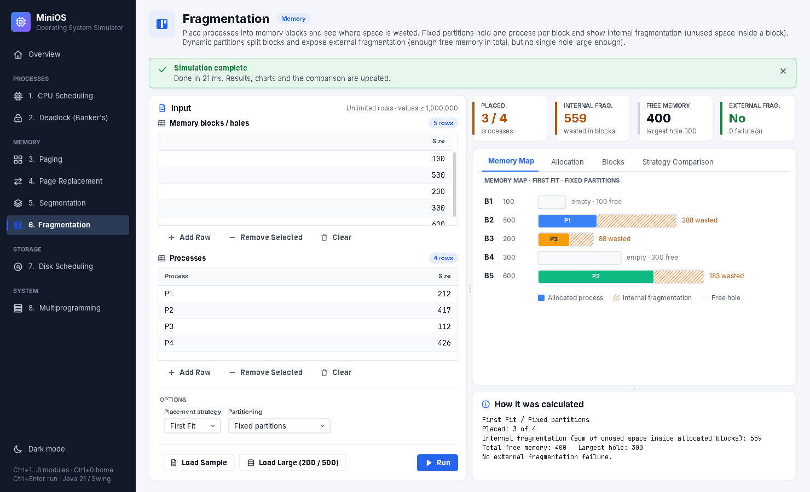 | 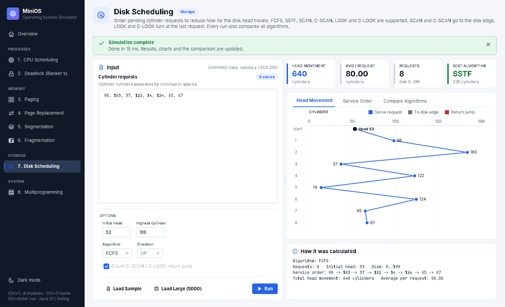 |
| 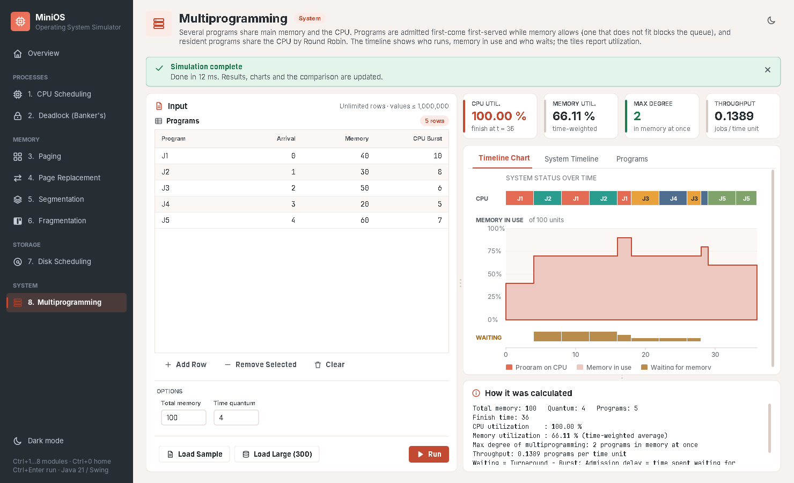 | 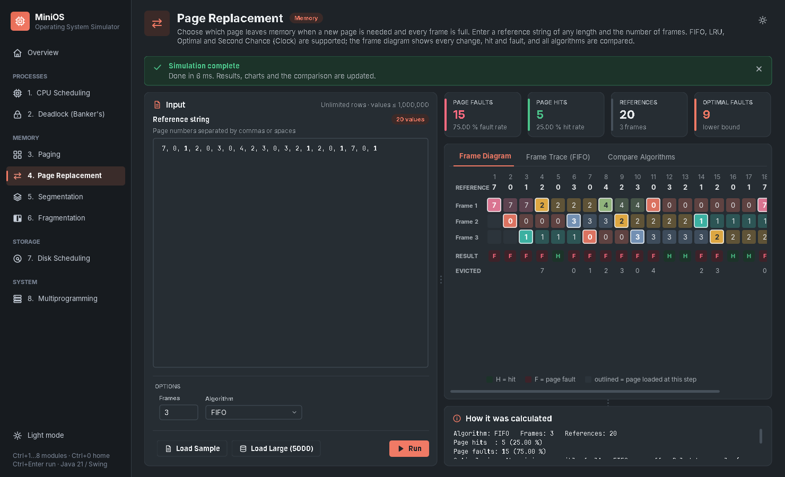 |

---

## 6. Interaction and error handling

1. **Load Sample** fills a small textbook dataset whose answer can be checked by hand, and an info banner says "press Run".
2. **Load Large** fills hundreds to thousands of random items, which proves there is no item limit.
3. **Run** (`Ctrl+Enter` from anywhere on the screen) validates, simulates, then shows "Done in N ms" and fills the tiles, tabs and explanation.
4. **Invalid input** never opens a dialog and never crashes. All validation goes through one path, `ModulePanel.guarded()`:
   * the banner names the field or row, e.g. *"Row 3 Burst: 'x' is not a valid whole number."*;
   * the matching field gets a red outline and keyboard focus, or the matching table row gets a red marker and scrolls into view;
   * fixing the value clears the highlight.
5. Options only work where they matter. The Round Robin quantum is enabled only for RR. Disk direction is enabled only for sweeping algorithms, and the "count return jump" option only for C-SCAN and C-LOOK.

| Row error | Field error |
|---|---|
| 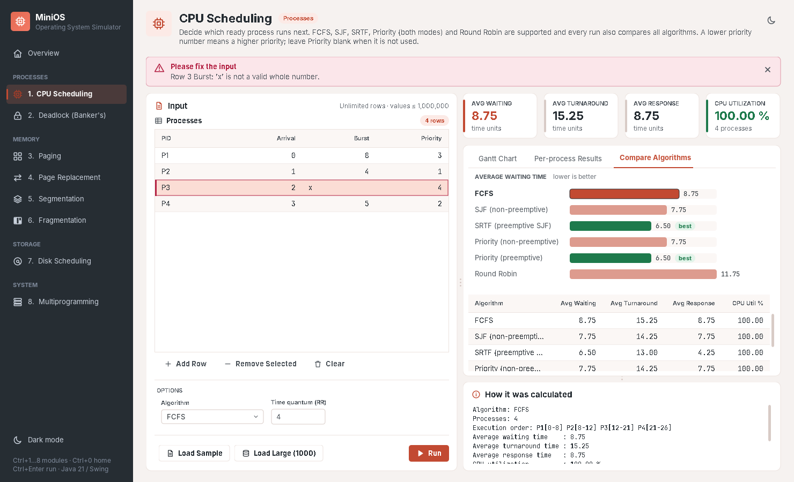 | 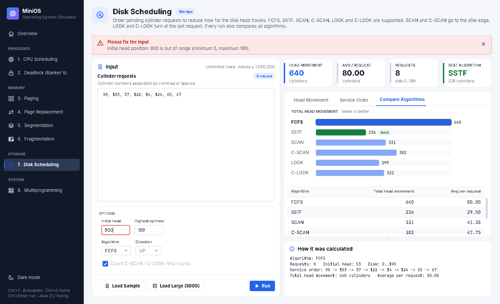 |

---

## 7. Accessibility and comfort

* Every text and status colour has at least 4.5:1 contrast against the card surface in both themes (WCAG AA for normal text; the lowest is hint text at 4.6:1). Status is never shown by colour alone: every coloured pill also carries a word or letter (HIT/FAULT, H/F, SAFE/UNSAFE, "best").
* Full keyboard use: Tab order follows the visual order, focus rings are visible, and tables support Insert to add a row and in-cell editing starts with a single click.
* Dark mode (`Ctrl+D`) helps with projector demos in a bright room or a long session in a dark one.

---

## 8. Keyboard shortcuts

| Keys | Action |
|---|---|
| `Ctrl+0` | Overview |
| `Ctrl+1` … `Ctrl+8` | open module 1–8 |
| `Ctrl+Enter` | Run the current module |
| `Ctrl+D` | toggle dark / light mode |
| `Insert` (in a table) | add a row |

(On macOS use `Cmd` instead of `Ctrl`.)

---

## 9. Code map (`src/ossim/ui`)

```
Theme, FlatUI, Icons, Ui, Tables,
WrapLayout, Segmented                 design system (tokens, Swing delegates, icons, widgets, table styling)
MainFrame, Sidebar, HomePanel         app shell, responsive navigation, overview
ModulePanel, OutputPane               page template, validation banner, stat tiles, result tabs
InputTable, MatrixTable               dynamic input editors
Chart (base) + GanttChart, HeadPathChart, BarChart, FrameGrid, MemoryMap,
SegmentMap, SequenceStrip, MemoryTimeline, PageMap                         module visuals
CpuPanel … MultiprogrammingPanel      one screen per module (input collection + result display only)
```

The layering is unchanged: `ui` never contains an algorithm and `core` never imports Swing. The redesign touched only the `ui` package, `Main`, and the GUI smoke test.
